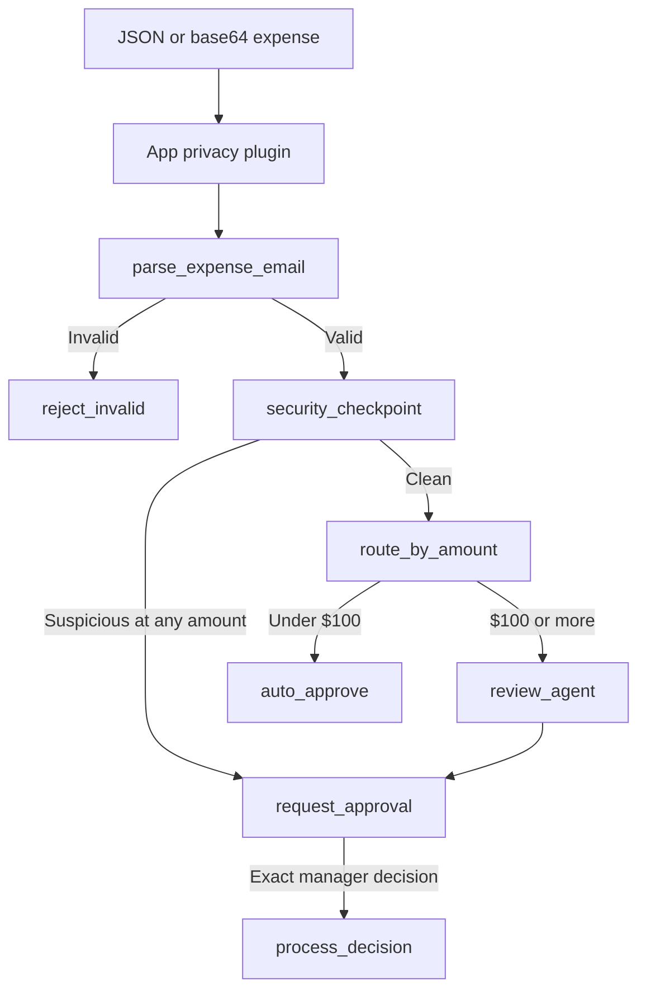

# System architecture

The application uses the Google ADK 2.0 graph Workflow API. The `App` registers a
privacy plugin; the webhook, evaluation harness, and Agent Runtime wrapper all
use that app so the plugin runs before session persistence and at model calls.

The shared ADK context state holds `expense_data`, `redacted_categories`, and
`security_flag`. Security flags reset on each expense. The threshold and existing
model (`gemini-3.1-flash-lite`) remain in `expense_agent/config.py`.

The model assesses risk and can emit a structured finance alert. Its
recommendation is advisory: all expenses at or above the threshold continue to
human review. `RequestInput` pauses the graph; a matching `adk_request_input`
function response resumes it. Free-text decisions must be exactly `approve` or
`reject` after trimming and case normalization.

The FastAPI `/pubsub` endpoint validates the Pub/Sub envelope, creates an
in-memory session per message, and runs the app asynchronously. Its HTTP `ok`
means workflow execution reached its current stopping point; high-value expenses
may still be waiting for human review. It is a prototype ingestion endpoint, not
a production approval UI or payment service. See `SECURITY.md` for boundaries
and deployment requirements.
