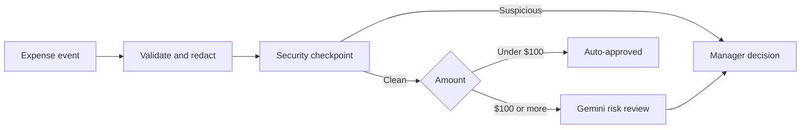

# Ambient Expense Approval Agent

An event-driven expense review workflow that keeps routine claims out of the
manual review queue and gives larger claims a risk assessment before a manager
decides. Built with Python, FastAPI, Google ADK 2.0, and Gemini.

The project explores a practical division of work: deterministic code enforces
approval rules, an LLM summarizes risk, and a human retains authority over
high-value claims. You can run the tests and a full workflow simulation without
an API key, or connect Gemini and try live review locally.

## What it does

| Submission | Model call | Outcome |
| --- | --- | --- |
| Valid, clean expense below $100 | No | Auto-approved |
| Valid, clean expense of $100 or more | Yes | Risk assessment, then mandatory manager review |
| Detected suspicious instructions at any amount | No | Security alert and direct manager review |
| Invalid payload, amount, or date | No | Rejected as invalid |

Every valid expense passes a security checkpoint before amount routing.
Supported SSN/card patterns are redacted before app-managed session storage and
model calls. A model recommendation never authorizes a high-value expense.



## Try it without an API key

Requires Python 3.11–3.13 and [uv](https://docs.astral.sh/uv/).

```bash
git clone https://github.com/Reefat004/Ambient_Expense_Approval_Agent.git
cd Ambient_Expense_Approval_Agent
uv sync --locked --all-extras
make test
make eval-offline
```

The offline evaluation executes the real ADK graph with a model stub over 20
synthetic scenarios: routing boundaries, human approval/rejection, supported PII
patterns, base64 input, suspicious instructions, and malformed expenses. It
prints a per-case PASS/FAIL table and exits nonzero on failure. This checks
orchestration and data boundaries; live model behavior is evaluated separately.

For a small end-to-end HTTP example with no provider call, follow the
[local demo](docs/LOCAL_DEMO.md).

## Try live Gemini review

```bash
cp .env.example .env
# Set GEMINI_API_KEY in .env, then:
uv tool install google-agents-cli
make playground
```

Paste [expense-review.json](examples/expense-review.json) into a playground
session. It uses this format:

```json
{
  "data": {
    "amount": 150.0,
    "submitter": "alice@example.com",
    "category": "software",
    "description": "Annual IDE license for client development",
    "date": "2026-10-24"
  }
}
```

The configured model, `gemini-3.1-flash-lite`, assesses risk and the workflow
pauses for a manager decision. Even a recommendation to approve still requires
that decision. Approval resumes through the matching `adk_request_input`
function response; the [local demo](docs/LOCAL_DEMO.md#human-review) explains it.

Flat expense JSON and base64-encoded JSON in `data` are also supported. Amounts
must be positive finite JSON numbers; all five fields are required. The
[small](examples/expense-small.json) and
[suspicious](examples/expense-suspicious.json) samples exercise the other routes.
Use synthetic data in local demonstrations.

## Commands

| Command | Purpose | Provider credentials |
| --- | --- | --- |
| `make test` | Unit and integration regression tests | Not required |
| `make eval-offline` | 20 scenarios with a recording model stub | Not required |
| `make eval` | Fresh live inference and deterministic grading | Required |
| `make serve` | Start the local Pub/Sub ingestion endpoint | Only for model-review routes |
| `make playground` | Open the ADK local playground | Only for model-review routes |
| `make lint` | Run Ruff lint and formatting checks | Not required |

The latest recorded validation has **92 passing tests**, **20/20 live scenarios**,
and **20/20 offline scenarios**. [CI](.github/workflows/ci.yml) runs lint, tests,
and offline evaluation on pull requests and pushes to `main`, without model
credentials. Live evaluations remain explicit because they incur provider calls
and can fail when the provider is unavailable.

## Design and evidence

- [Architecture](ARCHITECTURE.md): graph, shared state, and pause/resume behavior.
- [Local demo and API guide](docs/LOCAL_DEMO.md): sample requests, expected results,
  credential setup, and troubleshooting.
- [Security scope](SECURITY.md): redaction coverage and limits, trust boundaries,
  and operational requirements.
- [Security case study](SECURITY_REMEDIATION_REPORT.md): reproduced routing and
  trace-retention defects, fixes, regression coverage, and evaluation evidence.
- [Evaluation dataset](tests/eval/datasets/README.md): scenarios, artifact formats,
  and the difference between live inference and model-stub checks.
- [Contributing](CONTRIBUTING.md): development setup and checks.

Fresh live traces and grades are stored in `artifacts/traces/generated_traces.json`
and `artifacts/grade_results/results.json`. Offline files are labeled separately;
each run also keeps a timestamped copy. Historical model-graded results, an
interrupted provider run, and a corrected grader false positive are retained so
the evidence includes failures as well as successes. These evaluations are not
an independent security audit.

## Scope and next steps

This is a working local side project with deployment scaffolding. It has no
verified hosted deployment and does not issue payments or send notifications.
The webhook uses in-memory sessions and process-local duplicate detection.
Before real financial use, it needs authenticated event delivery and manager
authorization, durable workflow state, reliable retries, retention controls, and
a deployed smoke test. Regex redaction and phrase-based injection detection have
limits; see [SECURITY.md](SECURITY.md).

Next steps are durable session storage, a manager review UI with authenticated
resume/retry, and a verified development deployment.
